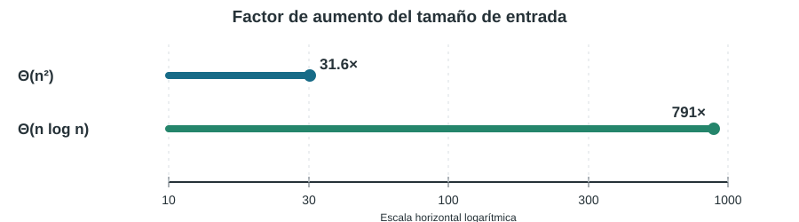

# Ejercicio 1. 
> **Enunciado.** Una computadora mil veces más rápida, ¿cuánto aumenta el tamaño de entrada que se resuelve en una hora con un algoritmo de costo $\Theta(n^2)$? ¿Y con uno de costo $\Theta(n\log n)$? Estimar los dos factores.

## Idea

Una computadora mil veces más rápida multiplica por $1000$ el presupuesto de operaciones disponible en una hora. Hay que ver cómo
crece el costo intrínseco del algoritmo.

Por ejemplo, para un algoritmo cuadrático, duplicar el tamaño cuadruplica el trabajo. Por eso, al multiplicar el presupuesto por $1000$, el tamaño solo puede multiplicarse aproximadamente por la raíz cuadrada de $1000$. En un algoritmo $n\log n$, el factor es mucho mayor: está cerca de $1000$.

## Resolución

Sea $N$ el número de operaciones que la computadora original puede ejecutar en una hora. La computadora nueva dispone de $1000N$ operaciones. Denotemos por $n_0$ el mayor tamaño resoluble con el presupuesto original y por $n_1$ el mayor tamaño resoluble con el nuevo presupuesto.

**Caso cuadrático.** Tomando como función representativa del costo $T(n)=n^2$, los tamaños satisfacen

$$

 n_0^2\leq N,\qquad n_1^2\leq 1000N.

$$

En el umbral de capacidad, la razón entre ambos tamaños queda determinada por

$$

 \frac{n_1}{n_0}\approx\sqrt{\frac{1000N}{N}}
 =\sqrt{1000}\approx31.62.

$$

Así, una mejora de mil veces en la velocidad permite resolver entradas aproximadamente $31.6$ veces mayores, no mil veces mayores.

**Caso $n\log n$.** En este caso el factor no es una constante independiente del tamaño inicial. Usando la función representativa $T(n)=n\log_2 n$, los umbrales satisfacen

$$

 n_0\log_2 n_0=N,\qquad
 n_1\log_2 n_1=1000N.

$$

Si $r=n_1/n_0$, al dividir la segunda igualdad por la primera se obtiene

$$

 r\,\frac{\log_2(rn_0)}{\log_2 n_0}=1000.

$$

Esta ecuación muestra por qué $r$ es algo menor que $1000$: el factor adicional $\log_2(rn_0)$ es mayor que $\log_2 n_0$.

Para dar una estimación numérica, tomamos el siguiente escenario: una computadora que ejecuta $10^9$ operaciones por segundo y un presupuesto de una hora. Entonces $N=3600\cdot10^9=3.6\cdot10^{12}$. Resolviendo numéricamente las ecuaciones anteriores:

| Costo | $n_0$ | $n_1$ | $n_1/n_0$ |
|---|---:|---:|---:|
| $n^2$ | $1.897\cdot10^6$ | $6.000\cdot10^7$ | 31.62 |
| $n\log_2 n$ | $9.857\cdot10^{10}$ | $7.801\cdot10^{13}$ | 791.37 |

> **Resultado.** Con mil veces más capacidad de cómputo, el tamaño resoluble crece aproximadamente $31.6$ veces para un costo cuadrático y $791$ veces para un costo $n\log n$, bajo el escenario numérico de referencia.