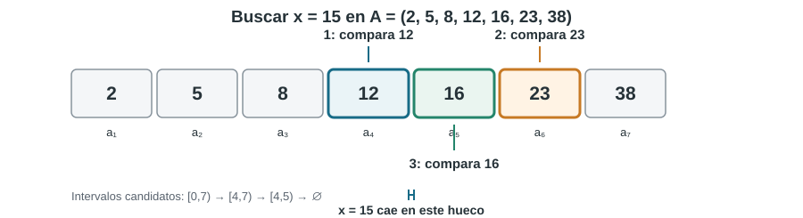

# Ejercicio 2.

> **Enunciado.** Dar el invariante y el potencial de la búsqueda binaria, y la cota de información que la hace óptima.

## Idea

Se compara el objetivo con el elemento central. Si el objetivo es menor, toda la mitad derecha queda descartada; si es mayor, se descarta toda la mitad izquierda. Cada comparación reduce (aproximadamente) a la mitad la región donde todavía podría estar el elemento.

La demostración de correctitud debe expresar que el objetivo, si aparece en el arreglo, nunca se elimina. La terminación se justifica observando que el intervalo candidato se hace estrictamente más pequeño. Para la cota inferior, aunque una búsqueda fallida siempre devuelve «no está», hay $n+1$ posiciones posibles (huecos) donde podría caer un valor ausente; el árbol de comparaciones debe distinguirlas.



## Algoritmo y demostración

Suponemos que $A[0],\ldots,A[n-1]$ está ordenado de forma no decreciente (el caso no creciente es análogo). El intervalo $[lo,hi)$ contiene los índices que todavía pueden albergar una aparición de $x$.

```python
def busqueda_binaria(A, x):
    lo, hi = 0, len(A)       # intervalo semiabierto [lo, hi)

    while lo < hi:
        mid = (lo + hi) // 2
        if A[mid] == x:
            return mid
        elif x < A[mid]:
            hi = mid
        else:
            lo = mid + 1

    return -1
```

**Invariante.** Al comienzo de cada iteración,

$$

 x\in A\quad\Longrightarrow\quad
 \text{existe }k\in[lo,hi)\text{ tal que }A[k]=x.

$$


*Inicialización.* Al principio $lo=0$ y $hi=n$, por lo que $[lo,hi)$ contiene todos los índices. El invariante es inmediato.

*Mantenimiento.* Sea $m=\lfloor(lo+hi)/2\rfloor$. Si $A[m]=x$, el algoritmo devuelve una posición correcta. Si $x<A[m]$, por el orden del arreglo ningún índice $k\geq m$ puede contener $x$; por eso se actualiza $hi=m$. Si $x>A[m]$, ningún índice $k\leq m$ puede contenerlo y se actualiza $lo=m+1$. En ambos casos, cualquier aparición de $x$ permanece en el nuevo intervalo y el invariante se conserva.

*Conclusión.* Si el algoritmo termina sin encontrar $x$, se tiene $lo=hi$ y el intervalo candidato está vacío. Por el invariante, $x$ no puede aparecer en el arreglo; luego devolver $-1$ es correcto.

**Potencial y terminación.** Definimos

$$

 \Phi=hi-lo.

$$

Es un entero no negativo. Inicialmente vale $n$. Si el intervalo tiene longitud $m>0$, al comparar con el elemento central y descartar una de las dos partes, la nueva longitud es a lo sumo $\lfloor m/2\rfloor$, y por tanto es estrictamente menor que $m$. En consecuencia, como $m$ se actualiza en cada iteración, el potencial disminuye en cada iteración y no puede hacerlo indefinidamente. El algoritmo termina. Además, como el intervalo se reduce al menos a la mitad, el número de comparaciones es $O(\log n)$.

## Cota de información y optimalidad

Para demostrar una cota inferior basta considerar búsquedas fallidas en un arreglo estrictamente creciente $a_1<\cdots<a_n$. Si $x$ no está en el arreglo, debe pertenecer a uno de los $n+1$ huecos: antes de $a_1$, entre elementos consecutivos o después de $a_n$.

Un algoritmo correcto debe llevar valores situados en huecos distintos a hojas distintas. En efecto, supongamos que $x_1<x_2$ pertenecen a huecos diferentes y llegan a la misma hoja. Entre ellos existe algún elemento $a_j$ del arreglo. El algoritmo no pudo haber comparado la consulta con $a_j$, pues $x_1$ y $x_2$ habrían tomado ramas diferentes. Si reemplazamos la consulta por $a_j$, todas las comparaciones realizadas con elementos situados fuera del intervalo entre $x_1$ y $x_2$ dan la misma respuesta; por tanto, también se llega a esa hoja. Pero allí el algoritmo declara que el elemento no está, aunque la consulta ahora es exactamente $a_j$. Contradicción.

Al restringir el árbol a consultas fallidas, ninguna comparación puede responder igual: solo quedan dos ramas, $x<a_i$ o $x>a_i$. El árbol binario necesita al menos $n+1$ hojas. Si su altura es $h$, tiene como máximo $2^h$ hojas, de modo que

$$

 2^h\geq n+1
 \quad\Longrightarrow\quad
 h\geq\left\lceil\log_2(n+1)\right\rceil.

$$

La búsqueda binaria divide los huecos posibles de la forma más equilibrada y alcanza esa altura en el peor caso. Por consiguiente, su número de comparaciones es óptimo en el modelo de comparaciones:

$$

\boxed{T(n)=\Theta(\log n).}

$$
