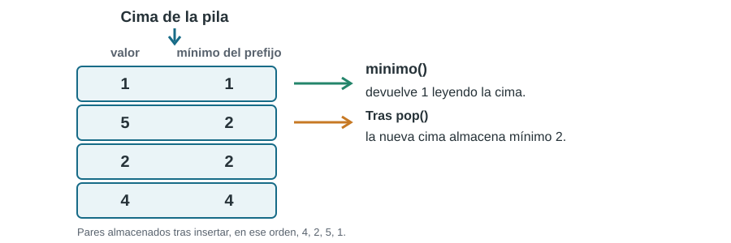

# Ejercicio 3.

> **Enunciado.** Diseñar una pila con una operación `minimo` que cueste $O(1)$ en el peor caso. Enunciar el invariante que garantiza su correctitud y dar el costo de cada operación.

## Idea

Una pila convencional permite consultar el elemento superior, pero encontrar el mínimo recorriendo todos sus elementos costaría $O(n)$. La solución sería guardar, junto a cada elemento, el mínimo de todo el prefijo de la pila que termina en esa posición.



## Estructura y operaciones

Representamos cada entrada de la pila mediante un par $(x,m)$: $x$ es el valor insertado y $m$ es el mínimo de todos los valores que están en esa posición o debajo de ella. Si la pila está vacía, no existe mínimo.

```python
def push(S, x):
    if not S:
        m = x
    else:
        m = min(x, S[-1][1])
    S.append((x, m))


def pop(S):
    if not S:
        raise IndexError("pop de pila vacia")
    x, _ = S.pop()
    return x


def minimo(S):
    if not S:
        raise IndexError("minimo de pila vacia")
    return S[-1][1]
```

**Invariante.** Si la pila contiene, de abajo hacia arriba, los pares

$$

 (x_1,m_1),(x_2,m_2),\ldots,(x_k,m_k),

$$

entonces para todo $i\in\{1,\ldots,k\}$ se cumple

$$

 \boxed{m_i=\min\{x_1,x_2,\ldots,x_i\}.}

$$

Es decir, la segunda componente de cada entrada es el mínimo del prefijo de la pila que acaba en esa entrada.

*Inicialización.* En una pila vacía el invariante se cumple vacíamente. Si se inserta el primer elemento $x_1$, se almacena $(x_1,x_1)$; por tanto, $m_1=x_1$, que es el mínimo del único elemento.

*Mantenimiento por `push`.* Supongamos que el invariante se cumple para una pila no vacía cuya cima tiene mínimo $m_k$. Al insertar $x_{k+1}$ se almacena

$$

 m_{k+1}=\min\{x_{k+1},m_k\}
 =\min\{x_1,\ldots,x_k,x_{k+1}\}.

$$

Las entradas anteriores no cambian, de modo que el invariante se conserva. Si la pila estaba vacía, es el caso de inicialización.

*Mantenimiento por `pop`.* La operación elimina únicamente el par superior. Los pares restantes no cambian y siguen satisfaciendo el invariante. El mínimo de la pila resultante queda almacenado en la segunda componente de su nueva cima.

*Correctitud de `minimo`.* Si la pila no está vacía, su cima es $(x_k,m_k)$. Por el invariante,

$$

 m_k=\min\{x_1,\ldots,x_k\},

$$

que es exactamente el mínimo de todos los elementos almacenados. La operación devuelve, por tanto, el valor correcto.

**Costos.** `push` realiza como máximo una comparación, construye un par y lo inserta: $O(1)$ en el peor caso. `pop` elimina y devuelve el par superior: $O(1)$ en el peor caso. `minimo` lee la segunda componente de la cima: $O(1)$ en el peor caso. La estructura almacena un par por elemento, por lo que usa $O(n)$ espacio total y $O(1)$ espacio adicional por elemento.