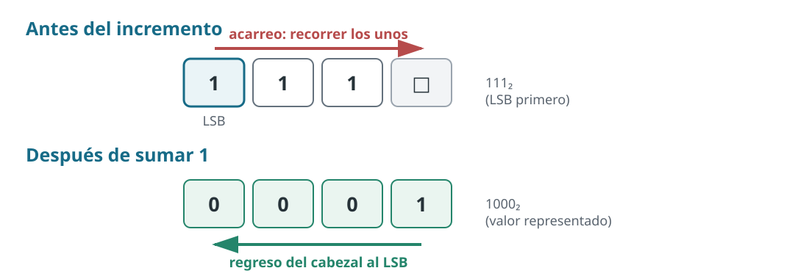

# Ejercicio 4.

> **Enunciado.** Diseñar una máquina de Turing de una cinta que sume 1 a un número escrito en binario, con el cabezal empezando en el bit menos significativo y volviendo a él al terminar. Determinar el costo en el peor caso de un incremento. Después, demostrar mediante un potencial que $m$ incrementos consecutivos desde $0$ cuestan $O(m)$ pasos en total, aunque un incremento aislado pueda costar $\Theta(\log m)$.

## Idea

Sumar uno en binario consiste en propagar un acarreo. Si el bit menos significativo es $0$, se cambia a $1$ y el trabajo es constante. Si es $1$, se cambia a $0$ y el acarreo continúa hacia la izquierda en la escritura convencional (o hacia la derecha si la cinta almacena primero el bit menos significativo). El proceso termina al encontrar un $0$, que se cambia a $1$, o al llegar al primer blanco, donde se escribe un nuevo bit $1$. Así que los peores casos consisten de números con mayor sufijo de unos, aunque a más caro el caso más raro es.

*Figura 1. Un acarreo sobre $111_2$: se visitan los tres unos, se escribe el nuevo bit y el cabezal vuelve al bit menos significativo. La cinta almacena los bits en orden de menor a mayor significancia.*

## Construcción de la máquina y costo de un incremento

Representamos el número con el bit menos significativo en la celda $0$ y los bits de mayor peso a su derecha. La celda que contiene ese primer bit lleva además una marca especial (dicha marca especial en una máquina de Turing, formalmente sería el blanco antes del inicio), que permite reconocer el punto al que debe volver el cabezal. A la derecha del bit más significativo hay blancos.

La máquina trabaja en dos fases. En la fase de acarreo, mientras lee un $1$, escribe $0$ y se mueve una celda a la derecha. Al encontrar un $0$ (o el primer blanco), escribe $1$ y pasa a la fase de retorno. En esta fase se mueve a la izquierda sin modificar los bits hasta encontrar la marca del bit menos significativo; allí se detiene. Si el primer bit ya es $0$, lo cambia a $1$ y termina en esa misma posición. Los detalles de las transiciones de frontera pueden añadir un número constante de pasos, irrelevante para las cotas asintóticas.

Sea $t(r)$ el número de unos consecutivos menos significativos del valor $r$ antes de incrementarlo. La máquina cambia esos $t(r)$ unos a cero, avanza hasta el siguiente cero o blanco y vuelve al inicio. Por tanto, existen constantes $c_1,c_2>0$ tales que

$$
c_1\bigl(t(r)+1\bigr)\leq C(r)\leq c_2\bigl(t(r)+1\bigr),
$$

donde $C(r)$ es el número de pasos de ese incremento. En particular, para un contador de $k$ bits, el peor caso ocurre cuando todos sus bits son unos: hay que propagar el acarreo a través de los $k$ bits y regresar. Así,

$$
\boxed{C_{\mathrm{peor}}(k)=\Theta(k).}
$$

Durante los primeros $m$ incrementos desde cero, el valor antes de cada operación pertenece a $\{0,1,\ldots,m-1\}$. Por ello $t(r)\leq\lfloor\log_2 m\rfloor$ y el peor incremento individual cuesta $O(\log m)$. Esta cota se alcanza en orden asintótico: entre esos valores aparece $2^k-1$, con $k=\lfloor\log_2 m\rfloor$, cuyo incremento tiene $k$ unos finales. Por tanto, para $m\geq2$,

$$
\boxed{\max_{0\leq r<m}C(r)=\Theta(\log m).}
$$

## Análisis amortizado con un potencial

Para acotar el costo de toda la secuencia, no analizamos cada incremento aisladamente. Definimos el potencial del contador como el doble de la cantidad de unos de su representación binaria:

$$
\Phi(r)=2\,\operatorname{popcount}(r).
$$

Es una función no negativa y $\Phi(0)=0$. Si un incremento comienza con $t$ unos finales, esos $t$ bits pasan de $1$ a $0$ y el siguiente bit, que era $0$ (o un blanco interpretado como cero), pasa a $1$. Por tanto,

$$
\operatorname{popcount}(r+1)=\operatorname{popcount}(r)-t+1,
\qquad
\Phi(r+1)-\Phi(r)=2(1-t).
$$

El costo real satisface $C(r)\leq 2t+c$ para una constante $c$ que absorbe los pasos de control y los casos de frontera. El costo amortizado de la operación es

$$
\begin{aligned}
\widehat C(r)&=C(r)+\Phi(r+1)-\Phi(r)\\
&\leq 2t+c+2(1-t)=c+2=O(1).
\end{aligned}
$$

Al sumar los costos amortizados de los $m$ incrementos, los cambios de potencial se telescopian:

$$
\begin{aligned}
\sum_{r=0}^{m-1}C(r)
&=\sum_{r=0}^{m-1}\widehat C(r)-\Phi(m)+\Phi(0)\\
&\leq (c+2)m,
\end{aligned}
$$

porque $\Phi(m)\geq0$ y $\Phi(0)=0$. En consecuencia,

$$
\boxed{\text{el costo de }m\text{ incrementos desde }0\text{ es }O(m).}
$$

Cada incremento necesita al menos un paso, de modo que el costo total también es $\Omega(m)$. Por tanto, bajo esta implementación, el costo total es en realidad $\Theta(m)$. O sea, un acarreo largo consume unos que habían acumulado potencial en operaciones anteriores; el potencial liberado paga tanto el recorrido de ida como el de vuelta.
