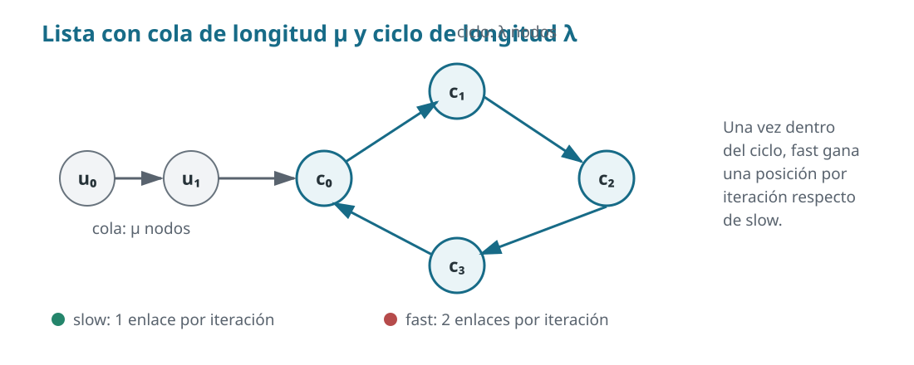

# Ejercicio 5.

> **Enunciado.** Detección de ciclos en una lista enlazada con dos punteros que avanzan a velocidades $1 y $2 (algoritmo de Floyd). Demuestra que se encuentran si y solo si hay un ciclo, con un invariante, y que termina,
con un potencial. Da el costo. 

## Idea

Si no existe un ciclo, es una cadena finita que termina en un puntero nulo. El puntero rápido avanza dos enlaces por iteración, así que llega al final antes que el lento. Después de $t$ iteraciones han recorrido $t$ y $2t$ enlaces, respectivamente, y en una cadena sin repeticiones esos lugares son distintos para $t>0$.

Si existe un ciclo, tarde o temprano ambos punteros estarán dentro de él. Como el rápido gana exactamente un enlace por iteración respecto del lento y el ciclo tiene un número finito de nodos, cada vez su diferencia (en número de enlaces) aumenta en 1, hasta acabar siendo cero módulo la longitud del ciclo. En ese instante ambos punteros ocupan el mismo nodo.



*Figura 2. Estructura de una lista con cola de longitud $\mu$ y ciclo de longitud $\lambda$. Una vez dentro del ciclo, el puntero rápido gana una posición por iteración respecto del lento.*

## Algoritmo

Ambos punteros comienzan en la cabeza. En cada iteración, el lento avanza un enlace y el rápido dos. Se compara la identidad de los nodos.

```python
def tiene_ciclo(cabeza):
    lento = cabeza
    rapido = cabeza

    while rapido is not None and rapido.next is not None:
        lento = lento.next
        rapido = rapido.next.next

        if lento is rapido:
            return True

    return False
```

## Invariante y correctitud

Sea $x_k$ el nodo al que se llega después de seguir $k$ enlaces desde la cabeza, siempre que ese recorrido esté definido. El invariante de posición es:

*Después de $t$ iteraciones completas, el puntero lento está en $x_t$ y el rápido está en $x_{2t}$, siempre que el rápido no haya alcanzado el final nulo.*

Caso base: para $t=0$, ambos están en la cabeza, $x_0$.

Supongamos que es cierto para t=k, luego están en posiciones $k$ y $2k$. Una iteración añade exactamente un enlace al recorrido del lento y dos al del rápido; por ello, las posiciones pasan a ser $k+1$ y $2k+2$. Esto demuestra el invariante.

Si el algoritmo devuelve verdadero, ha observado $x_t=x_{2t}$ para algún $t\geq1$. Al seguir los enlaces desde ese nodo durante $t$ pasos se regresa al mismo nodo. Existe, por tanto, un recorrido cerrado de longitud positiva y la lista contiene un ciclo. Esto demuestra que el algoritmo no produce falsos positivos.

Para la implicación contraria, supongamos que existe un ciclo. Denotemos por $\mu$ el número de nodos de la cola anterior al ciclo y por $\lambda\geq1$ la longitud del ciclo. A partir de la iteración $t\geq\mu$, ambos punteros están dentro del ciclo. Sus posiciones en él difieren en $t$ enlaces, pues el rápido ha avanzado $2t$ y el lento $t$. En consecuencia,

$$
x_t=x_{2t}\quad\Longleftrightarrow\quad t\equiv0\pmod{\lambda}
\qquad (t\geq\mu).
$$
Ahora bien, esto implica que la diferencia entre ambos punteros es de t posiciones, luego, dicha diferencia aumeta en 1 en cada iteración.

Existe un múltiplo positivo $M$ de $\lambda$ no menor que $\mu$; como la diferencia de las posiciones entre ambos punteros aumenta en 1 por cada iteración y es exactamente t, existe una iteración t donde los punteros coinciden ($t=M$) y el algoritmo devuelve verdadero. Así, todo ciclo acaba siendo detectado.

Hemos probado las dos direcciones:

$$
\boxed{\text{El algoritmo devuelve verdadero si y solo si la lista contiene un ciclo.}}
$$

## Terminación mediante un potencial

Hay dos casos, y en ambos podemos exhibir una función entera no negativa que disminuye en cada iteración ejecutada.

**Lista acíclica.** Sea $N$ el número de nodos alcanzables desde la cabeza. En la cabeza de una iteración, después de $t$ iteraciones completas, el rápido está en la posición $2t$ de la cadena. Definimos

$$
\Phi_{\mathrm{ac}}=N-2t.
$$

La condición del ciclo garantiza que el rápido todavía tiene al menos un enlace hacia un nodo no nulo, de modo que $\Phi_{\mathrm{ac}}\geq2$. Al avanzar dos enlaces, el potencial disminuye en dos; si el rápido alcanza el final nulo, el ciclo termina. Por tanto, no puede haber infinitas iteraciones.

**Lista con ciclo.** Sean $\mu$ y $\lambda$ como antes. Definamos $T$ como el menor múltiplo positivo de $\lambda$ que satisface $T\geq\mu$. Entonces $T$ existe y $T\leq\mu+\lambda$. Mientras el algoritmo no haya detectado el ciclo, usamos el potencial

$$
\Phi_{\mathrm{cic}}=T-t,
$$

donde $t$ es el número de iteraciones ya realizadas. Es un entero positivo y disminuye en uno en cada iteración. En $t=T$, ambos punteros están en el ciclo y $T$ es múltiplo de $\lambda$, así que coinciden y el algoritmo termina. El potencial llega a cero precisamente en ese momento, salvo que el algoritmo haya detectado la coincidencia antes.

## Complejidad

En una lista acíclica se realizan a lo sumo $O(N)$ iteraciones, porque el puntero rápido avanza dos enlaces por vuelta. En una lista cíclica, el encuentro ocurre a más tardar en la iteración $T\leq\mu+\lambda$, y $\mu+\lambda$ es el número de nodos distintos alcanzables. Cada iteración realiza un número constante de accesos y comparaciones de punteros. Por tanto, si $N$ denota el número de nodos distintos alcanzables (tanto si la lista termina como si entra en un ciclo),

$$
\boxed{T(N)=O(N)}
$$

El espacio auxiliar es constante porque solo se mantienen dos punteros, sin estructuras adicionales.
