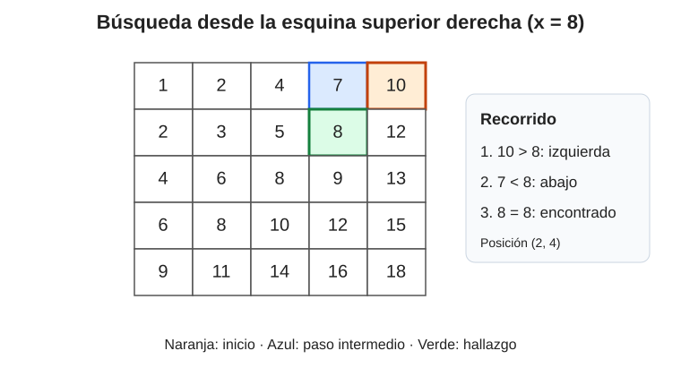

# Ejercicio 6.

> **Enunciado.** Una matriz tiene $n$ x $n$ filas y columnas ordenadas de forma creciente. Diseña un algoritmo que decida si contiene un valor $x$ en $O(n)$ comparaciones, demuestra su correctitud con un invariante, y
demuestra con un adversario que no se puede en $o(n)$.

#### Idea.

Una idea es aprovechar que es una matriz ordenada, y así recorrer el orden. La distancia Manhattan máxima entre dos elementos en una matriz cuadrada es de $2n-1$. Si se pudiera aprovechar la información del orden se podría buscar en $O(n)$.

Si se empieza desde la posición superior derecha, el elemento de esa posición es el mayor de su fila y el menor de su columna. Por eso, al compararlo con $x$, una de las dos direcciones queda completamente descartada. (Mismo caso, pero viceversa, si se empieza desde la posición inferior izquierda).

Si $M[i,j]>x$, todos los elementos de la columna $j$ situados en las filas $i,i+1,\ldots,n$ son todavía mayores; podemos eliminar esa columna y movernos a la izquierda. Si $M[i,j]<x$, todos los elementos de la fila $i$ situados en las columnas $1,2,\ldots,j$ son menores; podemos eliminar esa fila y movernos hacia abajo. Si son iguales, hemos encontrado $x$.

*Recorrido desde la esquina superior derecha. El color naranja indica el inicio, el azul el segundo paso y el verde el hallazgo.*

#### Algoritmo.

Usamos índices $i$ y $j$, que inicialmente señalan la primera fila y la última columna. El procedimiento es:

    i <- 1; j <- n
    while i <= n and j >= 1:
        if M[i,j] = x:
            return verdadero
        if M[i,j] > x:
            j <- j - 1       # descartar la columna j
        else:
            i <- i + 1       # descartar la fila i
    return falso

#### Correctitud.

El invariante al comienzo de cada iteración es el siguiente: si $x$ aparece en la matriz original, entonces aparece en la submatriz activa $$M[i\ldots n,\,1\ldots j].$$ Al inicio, $i=1$ y $j=n$, de modo que la submatriz activa es toda $M$; el invariante se cumple.

Supongamos que el invariante se cumple al comenzar una iteración y examinemos $y=M[i,j]$. Si $y=x$, el algoritmo devuelve verdadero y la respuesta es correcta. Si $y>x$, por el orden creciente de la columna $j$, para todo $r\geq i$ se tiene $M[r,j]\geq M[i,j]>x$. La columna $j$ no puede contener $x$ dentro de la región activa y se puede descartar actualizando $j\leftarrow j-1$. La posible ubicación de $x$ permanece en la nueva submatriz.

Si, por el contrario, $y<x$, por el orden creciente de la fila $i$, para todo $c\leq j$ se tiene $M[i,c]\leq M[i,j]<x$. La fila $i$ no puede contener $x$ dentro de la región activa y se puede descartar actualizando $i\leftarrow i+1$. De nuevo, cualquier aparición posible de $x$ permanece en la nueva submatriz. En todos los casos el invariante se conserva.

El ciclo termina cuando $i=n+1$ o $j=0$, es decir, cuando la submatriz activa queda vacía. Por el invariante, si $x$ estuviera en la matriz original tendría que estar en esa submatriz vacía, lo cual es imposible. Por tanto, devolver falso también es correcto. Además, el ciclo termina porque en cada iteración $i$ aumenta o $j$ disminuye, y ambos índices están acotados. Ergo, el algoritmo es correcto.

#### Complejidad.

Cada iteración incrementa $i$ o decrementa $j$. El primero puede incrementarse como máximo $n$ veces y el segundo puede decrementarse como máximo $n$ veces; por ello hay a lo sumo $2n-1$ iteraciones. Cada iteración realiza una cantidad constante de comparaciones (a lo sumo dos si se separan las pruebas de igualdad y orden). Por tanto, $$T(n)=O(n),\qquad S(n)=O(1),$$ donde $S(n)$ es la memoria (sin contar la necesaria para la entrada).

#### Cota inferior por adversario.

Mostraremos que cualquier algoritmo de búsqueda por comparaciones necesita $\Omega(n)$ comparaciones en el peor caso. Fijemos $x=0$ y construyamos una matriz $M_0$ mediante $$M_0[r,c]=
 \begin{cases}
 -1,&r+c\leq n+1,\\
  1,&r+c>n+1.
 \end{cases}$$ Las filas y las columnas son no decrecientes, y $M_0$ no contiene ceros. Las $n$ posiciones de la diagonal secundaria, $$d_r=(r,n+1-r),\qquad r=1,\ldots,n,$$ contienen todas el valor $-1$.

Para cada $r$, definamos $M_r$ como la matriz que coincide con $M_0$ salvo en la posición $d_r$, donde el valor $-1$ se sustituye por $0$. Cada $M_r$ sigue teniendo filas y columnas no decrecientes: en la fila y en la columna correspondientes, el valor cambiado queda entre los $-1$ anteriores y los $1$ posteriores. Además, $M_r$ sí contiene el valor buscado.

Consideremos la ejecución de un algoritmo correcto sobre $M_0$. Si una posición $d_r$ no interviene en ninguna comparación de esa ejecución, sustituir su valor por cero produce la entrada $M_r$ sin cambiar ninguna respuesta observada por el algoritmo. La ejecución y la salida serían idénticas sobre $M_0$ y $M_r$, aunque las respuestas correctas son distintas. Esto contradice la correctitud. Por tanto, cada una de las $n$ posiciones especiales debe intervenir en alguna comparación. Como una comparación entre dos celdas puede involucrar como máximo dos de esas posiciones (y una comparación de una celda con $x$ involucra solo una), hacen falta al menos $n/2$ comparaciones. En consecuencia, $$T(n)=\Omega(n).$$ Junto con la cota superior, obtenemos $$\boxed{T(n)=\Theta(n).}$$ El algoritmo de la esquina superior derecha es, por tanto, asintóticamente óptimo.