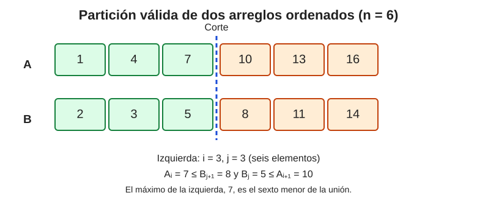

# Ejercicio 7. Mediana de dos arreglos ordenados

Sean $A=(a_1,\ldots,a_n)$ y $B=(b_1,\ldots,b_n)$ dos arreglos ordenados de longitud $n$. Se pide encontrar el elemento $n$-ésimo menor de los $2n$ elementos, en tiempo $O(\log n)$, demostrar la correctitud y dar una cota de información. Aquí la mediana es el elemento de rango $n$; no se pide promediar los dos elementos centrales.

#### Idea.

Mezclar los arreglos resolvería el problema, pero costaría $O(n)$. No hace falta conocer el orden de todos los elementos: basta identificar cuáles son los primeros $n$. Para ello cortamos ambos arreglos en una parte izquierda y una derecha, de modo que las izquierdas contenga exactamente $n$ elementos en total.

Pongamos que tomamos $i$ elementos de $A$ y $j$ de $B$, luego $i+j=n$, así que $j=n-i$. Como cada arreglo ya está ordenado, para comprobar que la partición es correcta basta mirar los dos pares que cruzan los cortes. Debe ocurrir que el último elemento tomado de $A$ no supere al primero dejado fuera de $B$, y que el último tomado de $B$ no supere al primero dejado fuera de $A$. Si ambas condiciones se cumplen, los $n$ elementos de la izquierda son precisamente los $n$ menores. La búsqueda se reduce entonces a encontrar $i$, que puede hacerse mediante búsqueda binaria.

La idea es que un índice determina el otro.

*Partición válida para n = 6. Hay seis elementos a la izquierda; el mayor de ellos es 7, el sexto menor de la unión.*

#### Condición de una partición correcta.

Usaremos índices desde $1$ hasta $n$ y añadiremos centinelas $$A_0=B_0=-\infty,\qquad A_{n+1}=B_{n+1}=+\infty.$$ Estos centinelas simplifican los casos en que no se toma ningún elemento de un arreglo o se toman todos. Elegimos un índice $i\in\{0,\ldots,n\}$ y ponemos $j=n-i$. La partición será correcta exactamente cuando $$A_i\leq B_{j+1}
  \quad\text{y}\quad
  B_j\leq A_{i+1}.
  \tag{1}$$ En efecto, dentro de cada arreglo el orden ya está garantizado. Las dos desigualdades verifican las únicas relaciones que faltan: que los elementos tomados de un arreglo no superen a los dejados a la derecha en el otro.

#### Algoritmo.

Buscamos el índice $i$ mediante búsqueda binaria. En cada iteración calculamos $j=n-i$ y comprobamos las dos desigualdades de la condición (1):

    lo <- 0; hi <- n
    while lo <= hi:
        i <- floor((lo + hi) / 2)
        j <- n - i
        if A[i] > B[j+1]:
            hi <- i - 1       # se tomaron demasiados de A
        elif B[j] > A[i+1]:
            lo <- i + 1       # se tomaron demasiado pocos de A
        else:
            return max(A[i], B[j])

#### Correctitud.

Primero observemos que existe al menos una partición válida. Consideremos la unión ordenada de los $2n$ elementos y tomemos sus primeros $n$ elementos. Si $i$ de ellos pertenecen a $A$ y $j$ a $B$, entonces $i+j=n$. Como se han tomado los $n$ menores, ninguno de los elementos tomados supera a uno de los elementos dejados fuera. Por tanto, se cumplen las dos desigualdades de la condición (1).

Ahora justificamos los movimientos de la búsqueda binaria. Si para el índice actual $i$ se cumple $A_i>B_{j+1}$, hemos tomado demasiados elementos de $A$. Además, ningún índice $i'\geq i$ puede ser válido: como los arreglos están ordenados y $j'=n-i'\leq j$, se tiene $$A_{i'}\geq A_i>B_{j+1}\geq B_{j'+1}.$$ Así, la primera desigualdad de la condición (1) también falla para todo $i'\geq i$, y podemos actualizar $hi\leftarrow i-1$.

Si se cumple $B_j>A_{i+1}$, hemos tomado demasiados elementos de $B$. Ningún índice $i'\leq i$ puede ser válido, pues $j'=n-i'\geq j$ y, por el orden de los arreglos, $$B_{j'}\geq B_j>A_{i+1}\geq A_{i'+1}.$$ La segunda desigualdad de la condición (1) falla para todo $i'\leq i$, así que actualizamos $lo\leftarrow i+1$.

Si ninguna de esas dos situaciones ocurre, las dos desigualdades de la condición (1) se cumplen y hemos encontrado una partición válida. La existencia demostrada al principio y el hecho de que nunca descartamos un índice válido garantizan que la búsqueda lo encontrará. Además, el intervalo de búsqueda se reduce en cada iteración, por lo que el procedimiento termina.

En una partición válida hay exactamente $i+j=n$ elementos a la izquierda, y las desigualdades aseguran que todos ellos son menores o iguales que todos los de la derecha. Por tanto, la parte izquierda contiene los $n$ elementos menores de la unión. El elemento de rango $n$ es su máximo, $$\boxed{\max(A_i,B_j).}$$ El algoritmo devuelve exactamente ese valor y es correcto. El argumento admite empates porque las condiciones se expresan con desigualdades no estrictas.

#### Complejidad.

El índice $i$ se busca en un intervalo de $n+1$ valores y cada iteración elimina una mitad. Se realizan $O(\log n)$ iteraciones y a lo sumo dos comparaciones por iteración. La memoria auxiliar es constante. Así, $$T(n)=O(\log n),\qquad S(n)=O(1).$$

#### Cota inferior por información.

Demostraremos que cualquier algoritmo basado en comparaciones necesita $\Omega(\log n)$ comparaciones en el peor caso. Restringimos la atención a entradas en las que los $2n$ elementos son distintos; basta obtener una cota inferior para este subconjunto de entradas.

Cualquiera de las $2n$ posiciones originales puede contener el elemento de rango $n$. Por ejemplo, fijado $i\in\{1,\ldots,n\}$, podemos construir una intercalación de los dos arreglos que coloque antes de $a_i$ exactamente los $i-1$ elementos $a_1,\ldots,a_{i-1}$ y los $n-i$ primeros elementos de $B$. En total hay $n-1$ elementos antes de $a_i$, de modo que $a_i$ ocupa el rango $n$. La intercalación respeta el orden interno de ambos arreglos. De forma análoga, cualquier $b_j$ puede ocupar el rango $n$: basta colocar antes de él los $j-1$ elementos anteriores de $B$ y los $n-j$ primeros de $A$.

En consecuencia, el árbol de decisión del algoritmo necesita al menos $2n$ hojas distintas: en cada una debe poder identificarse cuál de las $2n$ posiciones contiene la respuesta. Sobre las entradas con elementos distintos, cada comparación tiene dos resultados posibles, por lo que el árbol es binario. Un árbol binario de altura $h$ tiene como máximo $2^h$ hojas; así, $$2^h\geq 2n
  \quad\Longrightarrow\quad
  h\geq\lceil\log_2(2n)\rceil.$$ Por tanto, cualquier algoritmo de comparación necesita $\Omega(\log n)$ comparaciones en el peor caso. Combinando esta cota con el algoritmo construido, $$\boxed{T(n)=\Theta(\log n).}$$ La búsqueda binaria sobre la partición es asintóticamente óptima en el modelo de comparaciones.
