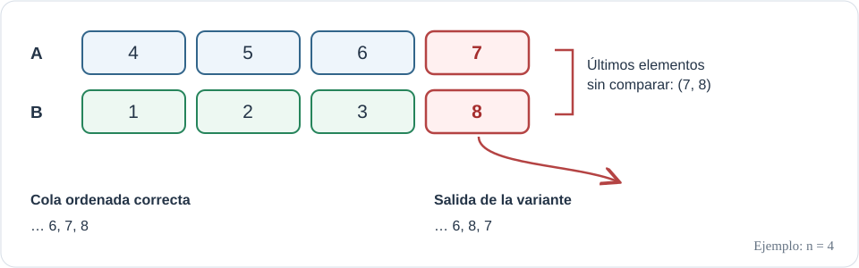

# Ejercicio 9

> **Enunciado** Una mezcla "optimizada" de dos listas ordenadas de largo $n$ deja de comparar cuando a la primera lista le queda un solo elemento, y lo pone al final. Cuenta cuántas comparaciones hace en el peor caso.
Sin probarla, usa la sección 6 de la conferencia 5 para decidir si es correcta, y construye con el
adversario la entrada en la que falla.

## Idea

Sean $A=(a_1,\ldots,a_n)$ y $B=(b_1,\ldots,b_n)$ dos listas ordenadas. La variante considerada compara los primeros elementos aún no consumidos, como en la mezcla habitual, pero detiene las comparaciones cuando queda un solo elemento de $A$. Si $B$ todavía tiene elementos, los copia primero y coloca al final el último elemento de $A$. Si $B$ se agota antes, copia normalmente lo que queda de $A$.

La intuición del posible fallo es sencilla: que quede un único elemento en $A$ no implica que sea mayor que todos los elementos pendientes de $B$. Para colocarlo al final habría que saberlo; justamente, la variante deja de hacer la comparación que podría decidir ese orden.

#### Número de comparaciones.

Sea $i$ la cantidad de elementos de $A$ ya consumidos y $j$ la cantidad de elementos de $B$ ya consumidos. Cada comparación consume exactamente un elemento, de modo que, al terminar el ciclo, el número de comparaciones es $i+j$. El ciclo continúa mientras $i<n-1$ y $j<n$.

Si termina porque $i=n-1$, entonces necesariamente $j\leq n-1$, y por tanto 

$$
i+j\leq (n-1)+(n-1)=2n-2.
$$

 Si termina porque $j=n$, entonces $i\leq n-2$, así que también $i+j\leq2n-2$. En consecuencia, la variante realiza a lo sumo $2n-2$ comparaciones.

Esta cota se alcanza, por ejemplo, con 

$$
A=(n,n+1,\ldots,2n-1),\qquad
 B=(1,2,\ldots,n-1,2n).
$$

 Primero se extraen, mediante comparación, los $n-1$ elementos iniciales de $B$, pues todos son menores que $a_1=n$. Después se extraen los primeros $n-1$ elementos de $A$, pues todos son menores que $b_n=2n$. Se han hecho exactamente 

$$
(n-1)+(n-1)=2n-2
$$

 comparaciones. Quedan $a_n=2n-1$ y $b_n=2n$ sin comparar. Por tanto, el peor caso exacto es 

$$
\boxed{T_{\mathrm{variante}}(n)=2n-2.}
$$

*Ejemplo para $n=4$: $A=(4,5,6,7)$ y $B=(1,2,3,8)$. La variante deja sin comparar el par final $(7,8)$ y coloca $7$ después de $8$.*

#### Correctitud y argumento de adversario.

La sección 6 de la Conferencia 5 establece que mezclar dos listas ordenadas de longitud $n$ requiere al menos $2n-1$ comparaciones en el peor caso. La variante acaba de mostrar que siempre realiza como máximo $2n-2$. Si fuese correcta para todas las entradas, contradijera esa cota inferior. Por tanto, no puede ser un algoritmo correcto.

También podemos construir explícitamente la ambigüedad que fuerza el adversario. Tomemos las listas anteriores y consideremos la segunda entrada 

$$
A'=(n,n+1,\ldots,2n-2,2n),\qquad
 B'=(1,2,\ldots,n-1,2n-1).
$$

 Ambas listas siguen ordenadas. En la ejecución sobre cualquiera de las dos entradas, las comparaciones tienen los mismos resultados: los primeros $n-1$ elementos de $B$ son menores que el primero de $A$, y los primeros $n-1$ elementos de $A$ son menores que el último de $B$. El algoritmo nunca compara $a_n$ con $b_n$.

Sin embargo, cambia cuál de las dos listas contiene el menor de esos dos elementos. En la primera entrada, $a_n=2n-1<b_n=2n$, por lo que el orden correcto exige colocar $A$ antes que $B$. En la segunda, $b'_n=2n-1<a'_n=2n$, por lo que el orden correcto exige colocar $B'$ antes que $A'$. La variante, que en ambos casos coloca el resto de $B$ y luego el último elemento de $A$, falla en la primera entrada y acierta en la segunda. Como las comparaciones no distinguen ambas entradas, no puede garantizar una mezcla correcta.