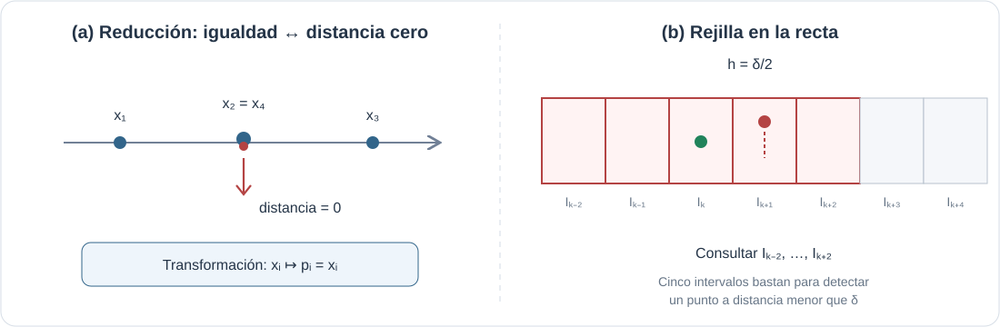

# Ejercicio 10.

> **Enunciado** Dada una colección de reales $X=\{x_1,\ldots,x_n\}$, queremos hallar dos elementos distintos cuya distancia $|x_i-x_j|$ sea mínima. Probar una cota inferior en árboles de decisión algebraicos, identificar el algoritmo de la Conferencia 2 que queda fuera de ese modelo y adaptar ese algoritmo a la recta.

#### Cota inferior por reducción.

Partimos del problema de distinción de elementos: dados $x_1,\ldots,x_n\in\mathbb R$, decidir si hay dos iguales. El teorema de Ben-Or, citado en la Conferencia 2, establece que este problema requiere profundidad $\Omega(n\log n)$ en el modelo de árboles de decisión algebraicos.

A partir de una instancia de distinción construimos una instancia de par más cercano colocando cada número sobre el eje real. La transformación es 

$$
x_i\longmapsto p_i=x_i\in\mathbb{R}.
$$

 Para cualquier par $i\ne j$ se tiene 

$$
\operatorname{dist}(p_i,p_j)=|p_i-p_j|=|x_i-x_j|.
$$

 En particular, 

$$
\min_{i<j}\operatorname{dist}(p_i,p_j)=0
 \quad\Longleftrightarrow\quad
 \exists i\ne j:\ x_i=x_j.
$$

 La transformación requiere tiempo lineal de representación y no realiza comparaciones entre los valores. Por tanto, si existiera un algoritmo para el par más cercano con profundidad $o(n\log n)$ en árboles de decisión algebraicos, podríamos resolver distinción de elementos con esa misma profundidad, añadiendo únicamente la comprobación de si la distancia mínima es cero. Esto contradice el teorema de Ben-Or. Concluimos que 

$$
\boxed{T(n)=\Omega(n\log n)\quad\text{en árboles de decisión algebraicos}.}
$$

En ese mismo modelo hay un algoritmo determinista que alcanza la cota: ordenar los números y examinar las $n-1$ parejas consecutivas. Basta mirar parejas consecutivas porque, si un par mínimo tuviera un elemento entre sus extremos en el orden, uno de los pares consecutivos entre ellos tendría distancia no mayor. Ordenar cuesta $O(n\log n)$ y recorrer los vecinos cuesta $O(n)$; así, el costo total es $\Theta(n\log n)$.

*La reducción convierte igualdad en distancia cero (a); en la adaptación aleatoria, una rejilla de intervalos permite consultar solo cinco celdas alrededor del nuevo punto (b).*

#### El algoritmo de la Conferencia 2 que sale de la cota.

La Conferencia 2 presenta un algoritmo incremental aleatorio: permuta los puntos al azar, los inserta uno a uno, mantiene la distancia mínima actual $\delta$ y organiza los puntos en celdas de una rejilla. Cuando la distancia mínima disminuye, reconstruye la rejilla con una escala nueva. En dos dimensiones se consultan 25 celdas cercanas; en una dimensión bastan cinco intervalos.

La adaptación a la recta funciona así. Tras insertar dos números, sea $\delta$ la distancia mínima entre ellos. Si $\delta=0$, ya encontramos dos iguales y terminamos. En otro caso, dividimos la recta en intervalos semiabiertos de longitud 

$$
h=\frac{\delta}{2},\qquad I_k=[kh,(k+1)h),\qquad
 k(x)=\left\lfloor x/h\right\rfloor.
$$

 Guardamos en una tabla hash el punto de cada intervalo ocupado. Cada intervalo contiene a lo sumo un punto: dos puntos en el mismo intervalo estarían a distancia estrictamente menor que $h<\delta$, contradiciendo la definición de $\delta$.

Al insertar un nuevo punto $p$, calculamos $k=k(p)$ y consultamos los cinco intervalos con índices $k-2,k-1,k,k+1,k+2$. Si algún punto $q$ estuviera a distancia menor que $\delta=2h$ de $p$, entonces $|p-q|<2h$ y sus índices de intervalo diferirían a lo sumo en dos. Por tanto, esas cinco consultas bastan. Si no aparece un punto más cercano, insertamos $p$ en su intervalo. Si aparece, actualizamos $\delta$ y reconstruimos la tabla para todos los puntos ya insertados usando intervalos de longitud $\delta/2$.

Una inserción ordinaria cuesta $O(1)$ consultas y una inserción en la tabla hash, suponiendo costo constante para las operaciones hash. Una reconstrucción en el paso $i$ cuesta $O(i)$, pero su probabilidad es a lo sumo $2/i$.

Para justificar la probabilidad, fijemos el conjunto $S_i$ de los primeros $i$ puntos e ignoremos el orden en que llegaron. Supongamos que no hay duplicados (si aparece uno, el algoritmo termina con distancia cero). Ordenemos los puntos como $y_1<\cdots<y_i$. La distancia mínima es el menor de los huecos consecutivos $y_{r+1}-y_r$. Si quitar un punto $y_s$ hace aumentar esa distancia, entonces todos los huecos que alcanzan el mínimo deben tocar a $y_s$; de lo contrario, quedaría intacto otro par a distancia mínima. En una cadena, si hay un solo hueco mínimo, como máximo sus dos extremos pueden cumplir esa condición. Si hay varios, todos tendrían que compartir un extremo común para que quitar un único punto los eliminara; en ese caso solo ese punto puede cumplirla. Por tanto, hay como máximo dos posibles últimos puntos cuya eliminación aumenta la distancia mínima. Como el orden de inserción es una permutación uniforme, condicionado a $S_i$, el último punto es uniforme entre sus $i$ elementos, y 

$$
\Pr(\text{reconstrucción en el paso }i)\leq\frac{2}{i}.
$$

 Así, el costo esperado de la reconstrucción en ese paso es 

$$
O(i)\cdot\frac{2}{i}=O(1).
$$

 Sumando las inserciones ordinarias y las reconstrucciones para $i=3,\ldots,n$, 

$$
\mathbb{E}[T(n)] = O(n)+\sum_{i=3}^{n}O(i)\frac{2}{i}
 =\boxed{O(n)}.
$$

La cota $\Omega(n\log n)$ se refiere a árboles de decisión algebraicos: cada nodo puede ramificar según el signo de un polinomio de grado acotado en la entrada. La rejilla usa operaciones que ese modelo no permite. En particular, calcula la parte entera $\left\lfloor x/h\right\rfloor$ para localizar el intervalo y emplea ese índice como dirección de acceso a una tabla hash. El algoritmo incremental no es, por tanto, un árbol de decisión algebraico. Entonces, no hay contradicción. Solo se obtiene tiempo lineal esperado en un modelo más potente, con direccionamiento indirecto mediante hashing y cálculo de índices.