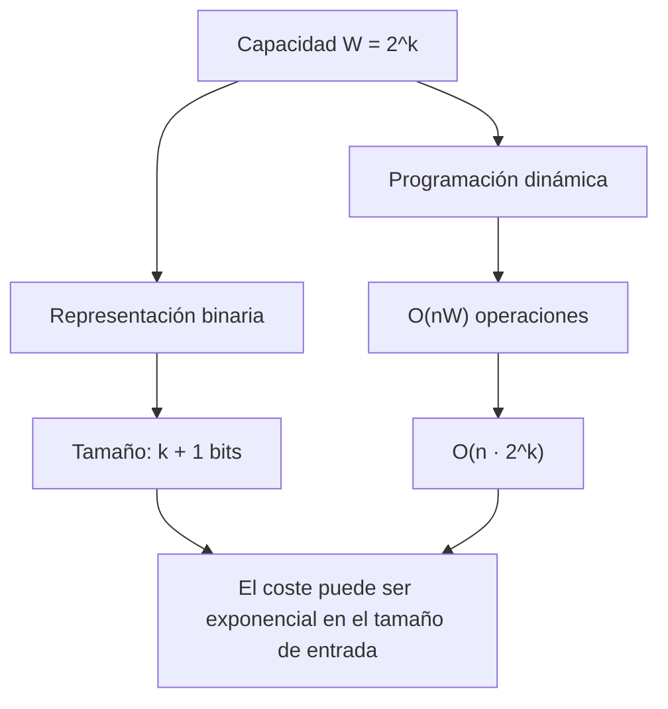

# Ejercicio 11.

> **Enunciado** El algoritmo de programación dinámica para la mochila entera tiene coste temporal $O(nW)$, donde $n$ es el número de objetos y $W$ es la capacidad de la mochila. Determinar si ese coste es polinomial respecto al **tamaño de la entrada en bits**, no respecto al valor numérico de $W$.

## 1. Tamaño de la entrada

Supongamos que cada objeto $i$ tiene un peso entero $w_i$ y un valor entero $v_i$, y que todos los números se codifican en binario. El número de bits necesarios para representar un entero positivo $x$ es:

$$

\operatorname{bits}(x)=\lfloor \log_2 x\rfloor+1.

$$

Por tanto, el tamaño de la entrada $L$ es, salvo constantes y delimitadores:

$$

L=\Theta\left(
 n+\log W+
 \sum_{i=1}^{n}(\log w_i+\log v_i)
\right).

$$

En particular, representar la capacidad $W$ requiere solamente:

$$

\Theta(\log W)

$$

bits.

Esto significa que una capacidad exponencialmente grande puede describirse con una cantidad de bits relativamente pequeña. Por ejemplo, $W=2^k$ necesita $k+1$ bits.

## Complejidad

El algoritmo tiene coste $O(nW)$, que es polinomial en el valor numérico de $W$, pero no necesariamente en el número de bits necesarios para representar la entrada.

Sea $k$ el número de bits de la capacidad. Entonces:

$$

W<2^k.

$$

El coste del algoritmo puede expresarse como:

$$

O(nW)=O(n2^k).

$$

Como $k$ forma parte del tamaño de la entrada, esta expresión puede ser exponencial respecto a dicho tamaño.

Podemos verlo con una familia de instancias sencillas:

- Un único objeto: $n=1$.
- Capacidad: $W=2^k$.
- Peso y valor del objeto: $w_1=v_1=1$.

La entrada necesita $\Theta(k)$ bits para representar la capacidad. Sin embargo, la implementación habitual de la programación dinámica recorre las capacidades de la mochila y realiza $\Theta(W)$ operaciones para ese objeto:

$$

\Theta(W)=\Theta(2^k).

$$

Por tanto, el algoritmo no garantiza un tiempo polinomial en el tamaño de la entrada binaria.

## Relación con la primalidad por división

La semejanza está en la diferencia entre el valor numérico de un dato y el número de bits que se necesitan para representarlo.

En el algoritmo elemental de primalidad por división, para comprobar si un número $N$ es primo se prueban posibles divisores hasta $\sqrt N$. Su coste es del orden de:

$$

O(\sqrt N)

$$

pruebas de divisibilidad.

Si $N$ está representado con $k$ bits, entonces:

$$

N<2^k

$$

y, por tanto, el número de pruebas puede llegar a ser del orden de:

$$

O(2^{k/2}).

$$

Este coste también es exponencial respecto al número de bits de la entrada.

En ambos casos, el algoritmo realiza un número de operaciones que depende de un valor numérico, aunque ese valor pueda representarse con muchos menos bits.